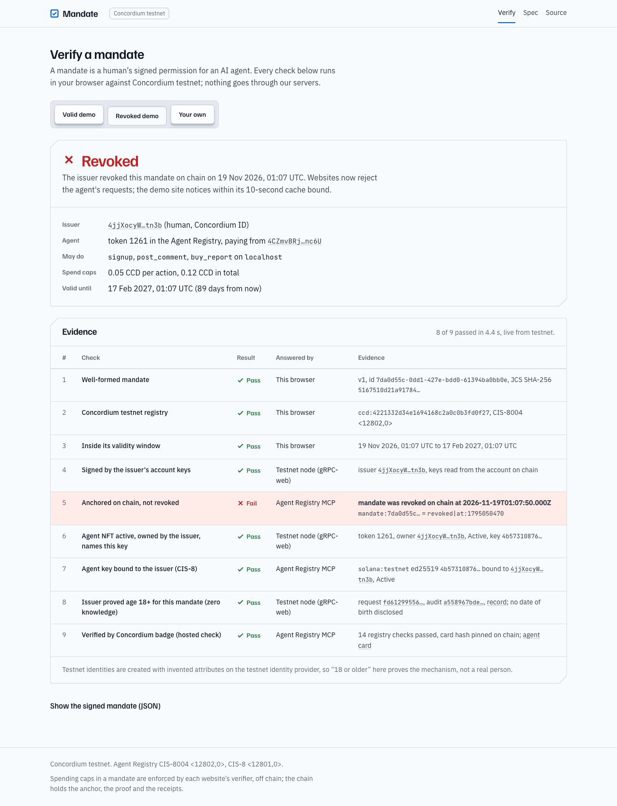

# Mandate

A verified adult gives an AI agent a scoped, expiring, revocable mandate: what it may do, on which sites, until when, and for how much. A website checks the agent's signed request and the mandate against Concordium, and lets the agent through instead of showing a CAPTCHA; paid actions settle with x402 in CCD. Every accepted action leaves an on-chain receipt, and the human revokes with one transaction.

- **Try it in the browser (live, testnet):** [verify the demo mandate](https://seunghyeon1004.github.io/mandate/verify/?m=demo-valid) or [a revoked one](https://seunghyeon1004.github.io/mandate/verify/?m=demo-revoked). Every check runs in your browser against Concordium testnet and names its source.
- **Evidence of a full run** with CCDExplorer links: [docs/EVIDENCE.md](docs/EVIDENCE.md).
- **Agent Card** (Verified by Concordium badge, plus our Mandate A2A extension): [agent-card.json](https://seunghyeon1004.github.io/mandate/agents/1261/agent-card.json); [hosted badge check](https://agent-registry-mcp.concordium.com/v1/check-badge/JyP9YMpKL9vhHC2hgA2pc?network=testnet).



## Concordium components, and where they are called

| Component | What Mandate uses it for | Code |
| --- | --- | --- |
| Concordium ID + Verify & Access | The human proves age >= 18 with an **account-bound** zero-knowledge proof made for this mandate id; the verifier anchors the request (VRA) and audit record (VAA). Any website re-verifies it: record hash pinned in the signed mandate, both anchors, `verifyWithNode`, credential resolves to the issuer's account. | [`proveAdult`](apps/console/src/issuer.ts#L137), [`holderPresentation`](apps/console/src/issuer.ts#L122), [`verifyAdultProof`](packages/mandate-chain/src/adult.ts#L35) |
| Agent Registry, CIS-8004 | The agent NFT (token 1261) names its signing key as its external reference; the mandate hash is anchored in the agent's metadata (`mandate:<id>`); revocation overwrites it. | [`registerAgent`](apps/console/src/issuer.ts#L56), [`issueMandate`](apps/console/src/issuer.ts#L166), [`revokeMandate`](apps/console/src/issuer.ts#L197), [`grpcAgentOf`](packages/mandate-chain/src/reads.ts#L42) |
| CIS-8 external key registry | The agent's ed25519 request key is bound to the human's account (scheme `solana-ed25519`). | [`registerAgent`](apps/console/src/issuer.ts#L69), [`grpcOwnerOfKey`](packages/mandate-chain/src/reads.ts#L63) |
| Agent Card + Verified by Concordium badge | Card built with the MCP, published on GitHub Pages, SHA-256 pinned with `setAgentURI`; hosted `check_badge` is valid with no issues. The card also declares our [Mandate A2A extension](https://seunghyeon1004.github.io/mandate/a2a-extensions/mandate/v1/). | [`buildCard`](apps/console/src/issuer.ts#L232), [`pinCard`](apps/console/src/issuer.ts#L267) |
| Agent Registry MCP server (hosted) | Reads (`get_metadata`, `owner_of_key`, `check_badge`), builders (`build_cis8_canonical_bytes`, `set_agent_wallet_canonical_bytes`, `build_agent_card`), with gRPC fallback when it is down; each check reports which source answered. | [`McpClient`](packages/mandate-chain/src/mcp.ts#L12), [`twoSource`](packages/mandate-chain/src/view.ts#L68) |
| x402 (CCD, self-hosted facilitator) | The agent pays from its registered agent wallet; the site aborts a payment from any other wallet and checks the mandate's spend caps before the 402 is shown. No public facilitator supports `ccd:*`, so the operator service runs one. | [site](apps/demo-site/src/main.ts#L79), [payer binding](packages/mandate-verifier/src/index.ts#L235), [facilitator](apps/facilitator/src/main.ts#L27), [agent](apps/agent/src/agent.ts#L44) |
| Sponsored transactions (protocol-level, V1) | The human's account holds 0 CCD: key binding, registration, anchors, card pin and revocation are all paid by a sponsor with an allow-list policy (dry-run before signing). x402 transfers are sponsored too. | [`buildSponsoredContractUpdate`](packages/mandate-chain/src/tx.ts#L70), [`sendContractUpdate`](packages/mandate-chain/src/tx.ts#L111), [policy](apps/facilitator/src/policy.ts#L46) |
| registerData | One receipt per accepted action, from the site's account: `MR1|<mandate sha256>|<action>|<request digest>|<time>`, shown as submitted, then finalized. | [receipts](apps/demo-site/src/receipts.ts#L33) |
| Web SDK, gRPC and gRPC-web | Node services, and the public verify page entirely in the browser (zero-knowledge verification in wasm). Contract schemas are loaded at runtime from the deployed modules, with a start-up check for every entry point used. | [`loadRegistry`](packages/mandate-chain/src/contracts.ts#L62), [verify page](apps/verify-page/src/main.ts#L108) |

## How a website decides (15 checks)

[`verifyMandateRequest`](packages/mandate-core/src/verify.ts#L163) returns every check with pass or fail, the reason, and the source that answered (`local`, `mcp`, `grpc`, `cache`):

1. Mandate headers present and well-formed; testnet registry. 2. The request (method, URL, body hash, timestamp, nonce, mandate hash) is signed by the agent key named in the mandate. 3. Fresh (60 s) and not a replay. 4. Inside its validity window. 5. Action and site in scope; price within the per-action and total caps (total held with an atomic reservation, so concurrent payments cannot overshoot). 6. Signed by the issuer's account keys. 7. Anchored on chain and not revoked. 8. Agent NFT active, owned by the issuer, naming this key. 9. Key bound to the issuer by CIS-8. 10. The issuer proved age >= 18 for this mandate.

A site installs it as Express middleware ([`MandateVerifier`](packages/mandate-verifier/src/index.ts#L125)): `app.post("/signup", MandateVerifier.rawBody(), verifier.require("signup"), handler)`. Revocable chain state is cached for at most 10 s (configurable), and the verifier fails closed (`503 chain_unavailable`).

## Run it locally on your own testnet accounts

Node 24. Everything binds to 127.0.0.1. Secrets go to `../.secrets` (testnet only, never printed).

```sh
git clone https://github.com/seunghyeon1004/mandate && cd mandate && npm ci
node scripts/demo.mjs setup   # ~3 min: two new testnet identities (invented attributes, self-service testnet IdP filled
                              # in Playwright's bundled Chromium), four accounts, three faucet drops, agent registration, a first mandate
node scripts/demo.mjs run     # operator service, demo site http://localhost:4021, console http://127.0.0.1:4020, scripted agent
```

Then revoke the mandate in the console and run `node apps/agent/src/cli.ts signup` again: the site rejects it as revoked. The badge needs the Agent Card on a public URL (`npm run mandate -- card`, publish `site/`, `npm run mandate -- pin-card`); the rest works without it.

Tests: `npm test` (unit, property and verifier table tests, offline), `npm run test:integration` (the full flow on testnet; rewrites docs/EVIDENCE.md), `npm run test:web` (Playwright, bundled Chromium, desktop and phone, axe).

## Repository

- `packages/mandate-core`: mandate schema, JCS canonicalisation, hash and anchor, human and agent signatures, `verifyMandateRequest`, `verifyMandate`.
- `packages/mandate-chain`: Concordium access (runtime schemas, gRPC + MCP reads, adult-proof re-verification, sponsored transactions).
- `packages/mandate-verifier`: Express middleware for websites.
- `apps/facilitator`: operator service (fee sponsor, x402 facilitator, audit-record host). `apps/console`: issuer CLI and web console. `apps/demo-site`: the demo website. `apps/agent`: the agent runtime (`callWithMandate`). `apps/verify-page`: the public verifier on GitHub Pages.
- [docs/PATH_TO_PRODUCTION.md](docs/PATH_TO_PRODUCTION.md), [NOTES.md](NOTES.md) (verified versions, findings not in the docs, decisions).

## Honesty notes

- **Testnet identity.** The human and operator identities were created on Concordium's self-service testnet identity provider with invented attributes ("Test Human", born 1990-01-01). "Verified adult" here proves the mechanism, not a real person.
- **Spending caps are off chain.** Each website's verifier enforces them; the on-chain anchor, receipts and payments are evidence after the fact. Protocol-Level Locks are not live and are not used.
- **Headless wallet.** In the demo the human's testnet key is held by the local console and the zero-knowledge presentation is made from the testnet identity headlessly; in production the Concordium wallet signs (`signMessage`, the same signature type) and answers the proof request. The wallet popup itself was not tested.
- **In-memory stores.** The replay guard and spend ledger are in memory (one process). The production design is in [docs/PATH_TO_PRODUCTION.md](docs/PATH_TO_PRODUCTION.md).
- **Before the build window.** Before 19 November 2026 there were design notes and throwaway spikes (not in this repository). The first commit of this repository is on 19 November 2026.
- **Use of AI in development.** This project was built by an AI coding agent (Claude, Anthropic) working under a human lead who set direction and reviewed each milestone; commits carry a `Co-Authored-By` trailer naming the model. Every claim in this README is backed by a test, a command or a transaction in docs/EVIDENCE.md.

License: Apache-2.0.
